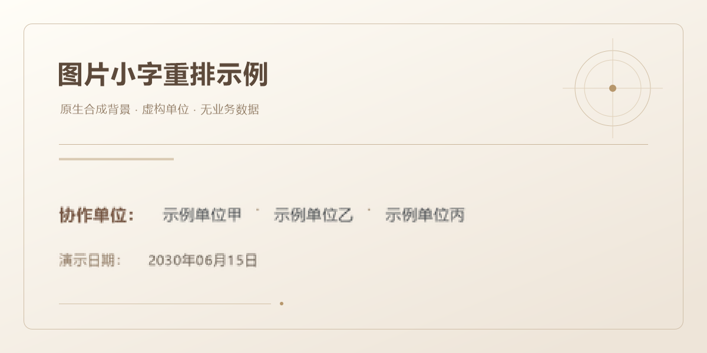
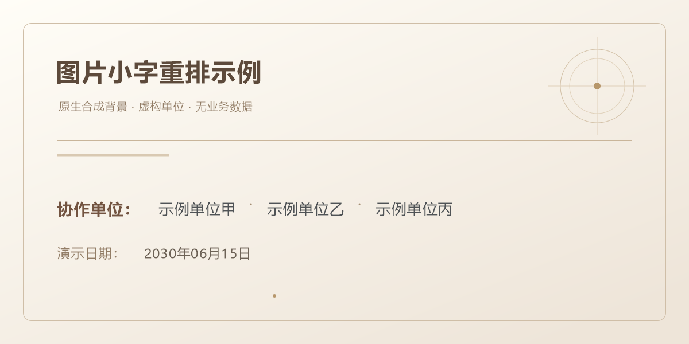

# image-text-retype

一个用于 Codex 的图片文字重排技能：在已有图片上清理指定旧字，用本机真实字体重新排字，输出与原图尺寸一致的 PNG。

A Codex skill for re-typesetting text in existing images with installed fonts, while checking image dimensions and pixels outside the permitted edit regions.

## 合成示例

以下示例使用合成图片模拟模糊小字，未使用业务数据。示例用于展示指定区域内清底和真实字体重排的流程，不代表所有真实物料都能获得相同效果。

| 重排前 | 重排后 |
| --- | --- |
|  |  |

示例清底图和配置见 [`examples/clean.png`](examples/clean.png) 与 [`examples/plan.json`](examples/plan.json)。

## 适用范围

适合海报、背景板、欢迎屏或截图中的小字模糊、笔画失真，但准确文案和原版式已经明确的情况。需要提供：

- 原始图片，以及核准的完整文字和顺序。
- 允许修改的区域、排版要求，或可供测量的原版式。
- 与原图构图和比例对齐的清底素材，用于替换指定区域的旧字背景。

这套流程包含人工测量、清底和视觉复核，不提供一键 OCR，也不负责超分辨率放大或从模糊笔画中恢复未知文字。

清底通常依赖 Codex 内置图像编辑能力，或用户已有的清底图。本地脚本本身不联网、不调用生成模型，也不会自动生成清底素材；能否使用内置图像编辑取决于当前 Codex 环境。

## 运行环境

- Windows，Windows PowerShell 与 `System.Drawing` 字体引擎。通过 PowerShell 7 调用时，渲染脚本会转交给本机 Windows PowerShell。
- Node.js 20.9.0 或更高版本，与 [`sharp`](https://sharp.pixelplumbing.com/) 0.35.5。
- 本机已安装、且包含所需字形的字体。默认使用建议为微软雅黑（`Microsoft YaHei`）；`plan.json` 必须显式写出字体名，也可改为其他实际存在的字体。
- 常规 8 位、单帧 RGB/RGBA 位图。16 位、多帧以及特殊色彩管理工作流不在本版本支持范围内。

字体文件、模型和业务图片不随技能分发。脚本不会下载运行依赖。

## 安装

将仓库放到个人 Codex 技能目录。目标目录应尚不存在，已有同名技能时请先自行安排保留或更新。

```powershell
$skillDir = Join-Path $env:USERPROFILE '.codex\skills\image-text-retype'
git clone https://github.com/Hellplus/image-text-retype.git $skillDir
Set-Location -LiteralPath $skillDir
npm install --omit=dev
```

也可以在 [Releases](https://github.com/Hellplus/image-text-retype/releases) 下载技能 ZIP，将其中的 `image-text-retype` 文件夹解压到个人技能目录，确认 `SKILL.md` 位于该文件夹根部，再进入文件夹安装依赖。

安装依赖这一步需要访问 npm；后续两个本地脚本不联网。如果环境已提供 `sharp`，也可以通过 `NODE_PATH` 使用现有模块，无需重复安装。安装后按当前 Codex 环境的方式重新加载技能。

## 使用

1. 在 Codex 中指定使用 `image-text-retype`，提供原图和准确文案。
2. 测量原图像素坐标，按 [配置与运行](references/plan-format.md) 建立 UTF-8 的 `plan.json`。每个文字条目是一行，坐标对应可见文字墨迹左上角；所有新字都必须处于允许修改的区域内。
3. 用可用的图像编辑工具清理旧字及描边，或提供已有清底图。复杂背景使用 `plate`；不透明的平滑浅底或低频渐变可使用 `matched-band`，并指定无字的上下采样行。
4. 在任务文件夹运行以下两个脚本。示例假定已设置 `$skillDir`，当前文件夹包含 `original.png`、`clean.png` 和 `plan.json`。

```powershell
& powershell -NoProfile -ExecutionPolicy Bypass -File (Join-Path $skillDir 'scripts/render_text_layer.ps1') -PlanPath 'plan.json' -OutputPath 'text-layer.png' -ReportPath 'text-layer.report.json'

& node (Join-Path $skillDir 'scripts/compose.cjs') --source 'original.png' --clean-plate 'clean.png' --text-layer 'text-layer.png' --plan 'plan.json' --output 'final.png' --report 'final.report.json'
```

`-ExecutionPolicy Bypass` 仅用于本次已审阅脚本的进程，不修改持久执行策略。输出和报告的父目录必须已存在，文件名必须为新名称；重复试排时使用新版本名。

5. 查看整图，并按原尺寸逐个检查修改区域：文案与顺序、字体字形、裁字与碰撞、旧字或白描边残留、背景接缝和色差。脚本通过后仍需视觉确认。

完整工作流程见 [SKILL.md](SKILL.md)，参数及清底方式见 [references/plan-format.md](references/plan-format.md)。

## 测试

安装依赖后，在仓库目录运行：

```powershell
npm run test:compose
npm run test:render
```

测试使用合成素材检查相应脚本行为。渲染测试需要 Windows 及测试配置所用的默认字体环境；缺少字体时应先安装或按测试说明调整环境。测试通过不能代替对实际成品的视觉复核。

## 复跑合成示例

示例已提供清底素材，不需要联网调用图像生成。将 `$skillDir` 指向仓库，并使用全新的输出目录：

```powershell
$demoDir = Join-Path $skillDir 'demo-output-001'
New-Item -ItemType Directory -Path $demoDir
& powershell -NoProfile -ExecutionPolicy Bypass -File (Join-Path $skillDir 'scripts/render_text_layer.ps1') -PlanPath (Join-Path $skillDir 'examples/plan.json') -OutputPath (Join-Path $demoDir 'text-layer.png') -ReportPath (Join-Path $demoDir 'text-layer.report.json')
& node (Join-Path $skillDir 'scripts/compose.cjs') --source (Join-Path $skillDir 'examples/before.png') --clean-plate (Join-Path $skillDir 'examples/clean.png') --text-layer (Join-Path $demoDir 'text-layer.png') --plan (Join-Path $skillDir 'examples/plan.json') --output (Join-Path $demoDir 'retyped.png') --report (Join-Path $demoDir 'retyped.report.json')
```

后续重跑改用另一个新目录，保留示例原图和已有输出。

## 输出与保护检查

| 输出 | 内容 |
| --- | --- |
| `text-layer.png` | 与原图画布尺寸一致的透明文字层 |
| `text-layer.report.json` | 实际字体、文字墨迹边界、行数及可选数量核对 |
| `final.png` | 与原图宽高一致的完整 PNG |
| `final.report.json` | 原图合成前后 SHA-256、成品 SHA-256、修改区域及像素检查结果 |

渲染器会拒绝未安装字体、文字越界和文字边界框相交等配置。合成器会检查清底图比例、文字层范围、原图文件 SHA-256，以及允许区域之外的 RGBA 像素；原图透明度也必须保持一致。已有输出或报告文件会被拒绝覆盖，输入文件不会作为输出写入。

像素检查以合成器统一解码到 sRGB/RGBA 后的原图为基准，不代表保留原文件编码、元数据或完整色彩配置。清理区域内的背景属于修补结果，需要单独检查。报告中的 `SELF_CHECKED_AWAITING_VISUAL_REVIEW` 表示自动检查通过、仍待视觉复核，不等同于用户验收或印刷验收。

## 限制

- 文字外观取决于所选字体及 Windows 字体引擎；不保证彩色 Emoji 或复杂文字塑形效果。
- `matched-band` 需要干净、无字且不透明的采样行；复杂纹理应使用合适清底稿，并逐区检查接缝。
- 本版本面向上述 Windows 流程，不承诺跨平台运行，也不将单个素材上的结果推广为所有背景都适用。

版本范围见 [v1.0.0 发布说明](RELEASE_NOTES_v1.0.0.md)。

## 许可证

采用 [MIT 许可证](LICENSE)。

Copyright (c) 2026 Hellplus
